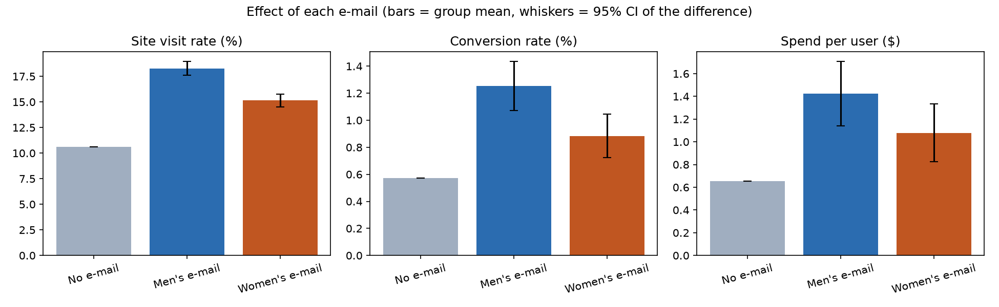
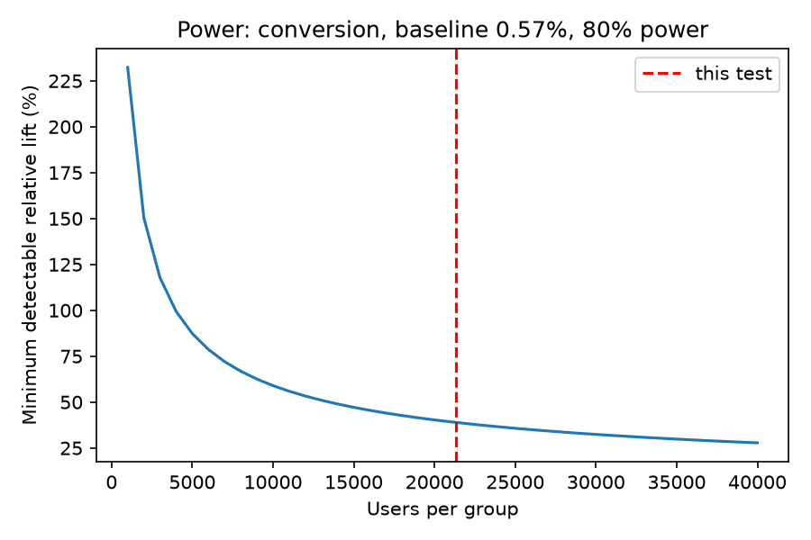
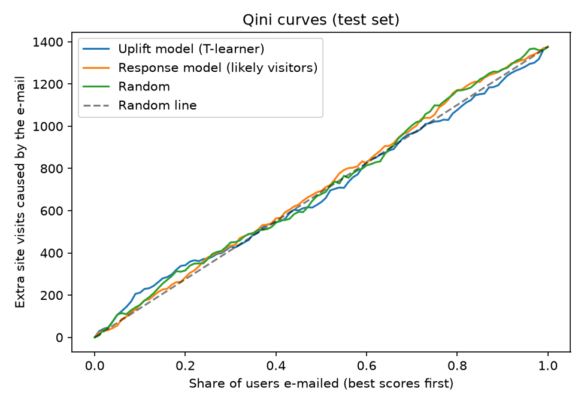
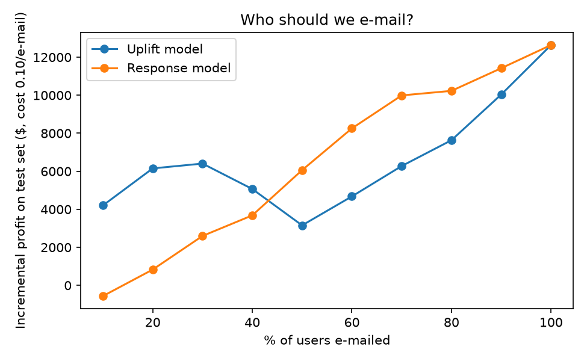
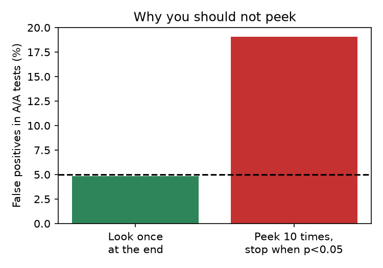

# A/B Testing and Uplift Modeling (E-mail Marketing)

[](https://github.com/BilalBess/ab-testing-uplift/actions/workflows/ci.yml)

A complete, careful analysis of a randomised e-mail campaign (64,000 customers): was the experiment valid, did the e-mails work, how sure are we, and **should we target only some customers?**
The statistics are written in small tested functions (`src/ab_stats.py`) so every number can be traced.

## The experiment
Hillstrom's *MineThatData* e-mail challenge: 64,000 customers randomly split in three equal groups:
- **Men's e-mail** (21,307), **Women's e-mail** (21,387), **No e-mail** = control (21,306).

Outcomes in the 2 weeks after the e-mail: site **visit**, **conversion** (purchase) and **spend** (dollars).
Customer features: recency, past spend, men's/women's purchase history, new customer, zip type, channel.

## Method
1. **Randomisation check**: standardised mean differences and chi-square tests between groups.
2. **Effect of each e-mail** vs control on visit and conversion (two-proportion test, 95% CI) and on spend (bootstrap CI, because spend is mostly zeros with a long tail).
3. **Multiple testing**: 6 tests in the family, p-values adjusted with Holm's method.
4. **Bayesian view** (Beta-Binomial): probability that an e-mail is better, and expected loss.
5. **Variance reduction**: regression adjustment on covariates.
6. **Power analysis**: what effect could this test detect, and how many users would other effects need?
7. **Subgroup effects** with interaction tests (and a warning about fishing for results).
8. **Uplift modeling**: T-learner (gradient boosting and logistic regression) to rank customers by *incremental* effect, evaluated with Qini curves / AUUC and compared with a plain "response" model, on 10 different splits.
9. **Peeking simulation**: how many false positives do you get if you stop the test as soon as p < 0.05?

## Results

### 1. The experiment was properly randomised
All standardised mean differences are below 0.01 (the usual limit is 0.1) and the chi-square tests for zip type and channel give p = 0.58 and 0.46.

### 2. Both e-mails work, men's e-mail works better
| | Control | Men's e-mail | Women's e-mail |
|---|---|---|---|
| Visit rate | 10.6% | **18.3%** (+7.7 pts, 95% CI 7.0 to 8.3) | 15.1% (+4.5 pts, CI 3.9 to 5.2) |
| Conversion rate | 0.57% | **1.25%** (+0.68 pts, CI 0.50 to 0.86) | 0.88% (+0.31 pts, CI 0.15 to 0.47) |
| Spend per customer | $0.65 | **$1.42** (+$0.77, CI 0.49 to 1.05) | $1.08 (+$0.42, CI 0.17 to 0.68) |

All 6 effects stay significant after Holm's correction (the largest adjusted p-value is 0.001). The men's e-mail beats the women's e-mail on visit and conversion (p < 0.001); on spend the gap is $0.35 (CI 0.03 to 0.66, raw p = 0.03), which is only borderline once we consider that we made several comparisons.



The Bayesian analysis agrees: the probability that each e-mail beats the control on conversion is above 99.9%.

### 3. Regression adjustment barely helps here
The standard error of the spend effect goes from 0.1452 to 0.1451. Because the groups were randomised, the effect estimate was already unbiased, and these covariates explain very little of the spend (which is mostly zeros). Variance reduction works well only when a covariate predicts the outcome strongly (for example spend before the test).

### 4. Power: this test could detect large effects only for conversion
With about 21,300 users per group and a 0.57% baseline conversion, the smallest relative lift this test can detect with 80% power is **about 39%**. To detect a 10% lift, you would need about **286,000 users per group**. The observed lifts (+54% and +119%) are above this threshold, so the test was well sized for them. A "not significant" result for a small effect would not have meant "no effect".



### 5. Subgroup effects: be careful
The visit lift is similar everywhere (about +6 to +10 points in each channel, zip type and past-spend segment).
Interaction tests give p = 0.0005 for new vs existing customer, 0.028 for zip type, 0.10 for channel and 0.53 for past-spend segment (after Holm: 0.002, 0.083, 0.199, 0.525).
The "new customer" result looks significant, but the visit lift is +7.8 points for existing and +7.5 points for new customers: the difference is **tiny on the scale that matters for the business**. The interaction is significant only on the log-odds scale of the logistic model, because the two groups have different base rates. A significant interaction does not mean a useful difference. It is a good example of why subgroup analysis needs both a correction for multiple tests and a look at the effect size.

### 6. Uplift modeling: little to gain here
I ranked customers by predicted incremental visit probability and measured the area under the Qini curve (AUUC, 0 = random targeting) on 10 random splits:

| Scoring | AUUC (mean, std over 10 splits) |
|---|---|
| Random | -1.8 (18.9) |
| Uplift, gradient boosting T-learner | 13.9 (23.5) |
| Uplift, logistic T-learner | 19.7 (16.9) |
| "Response" model (who visits anyway) | 37.3 (25.7) |

- The models are better than random, but **the spread between splits is as large as the gaps between models**, so I cannot say that the uplift models beat the simple response model. On this dataset the response model was even better on average.
- The reason is that the e-mail effect is **homogeneous**: almost everybody visits more. When the treatment effect is about the same for everyone, there is not much for an uplift model to find.
- **Business decision**: with an assumed cost of $0.10 per e-mail, the incremental spend is $0.84 per customer when e-mailing everyone, far above the cost. In the test split, the best policy is to e-mail **everybody** (profit about $12,600 on 17,046 customers). Targeting only the top 20-30% does not make more money.




### 7. Why you should not peek
In a simulation of A/A tests (both groups identical), checking the p-value 10 times and stopping at the first p < 0.05 gives **19% false positives** instead of 5%. Looking once at the planned end gives 4.9%.



## Limitations
- One campaign, from a retailer, in 2008. I cannot say how these effects transfer to other products or periods.
- The outcomes cover only 2 weeks. The e-mail may just pull forward purchases, or hurt in the long run (unsubscribes are not measured).
- Spend is zero-inflated and heavy-tailed; the bootstrap handles the CI but a few big purchases still drive the mean.
- The dollar amounts in the targeting policy depend on an assumed e-mail cost ($0.10) and ignore margins.
- AUUC is noisy on 17k test users with rare outcomes (see the standard deviations above); the policy table is estimated on the same test split used to choose the share to target, so it is slightly optimistic.
- Not tested: a model for conversion or spend as the uplift target (too rare/noisy to learn from in this sample size).

## How to run
```bash
pip install -r requirements.txt
python src/analysis.py      # downloads the data (4 MB), writes reports/ and figures
pytest -q                   # 11 tests on the statistics helpers
```

## Tests
The tests check the statistics against known values (two-proportion test, Holm correction, sample size and detectable lift), the bootstrap coverage, the peeking simulation, and that the uplift code finds a treatment effect planted in synthetic data. They run on every push with GitHub Actions (ruff, then pytest).

## Skills shown
Experiment design and analysis, hypothesis testing, confidence intervals, multiple testing, power analysis, Bayesian A/B testing, bootstrap, uplift modeling (Qini/AUUC), scientific honesty about null results.
